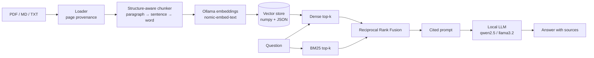

# AskMyDocs

**Chat with your PDFs and notes, 100% locally.** AskMyDocs is a retrieval-augmented generation (RAG) engine that combines dense embeddings with BM25 keyword search, fuses them with Reciprocal Rank Fusion, and answers with numbered citations back to the exact file and page.

No API keys. No cloud. Your documents never leave your machine.

  

<!-- author-banner -->
> **Project 01 of 20** in my AI build series, designed and built by **[Abbishekk DGS](https://abbishekkdgs.tech)**. [See all projects →](https://github.com/Abbishekk-DGS)

## Why it's different

| | Typical "chat with PDF" demo | AskMyDocs |
|---|---|---|
| Retrieval | vector search only | **hybrid**: vectors + BM25, fused with RRF |
| Exact terms (invoice IDs, names) | often missed | caught by BM25 |
| Answers | free text | **cited** `[n]` → file + page |
| Re-indexing | duplicates chunks | content-hashed, idempotent |
| Dependencies | LangChain + vector DB | `httpx`, `numpy`, `pypdf` |

## Architecture



## Quickstart

```bash
# 1. Install Ollama (https://ollama.com) and pull two small models
ollama pull qwen2.5:3b
ollama pull nomic-embed-text

# 2. Install AskMyDocs
git clone https://github.com/Abbishekk-DGS/ask-my-docs && cd ask-my-docs
uv sync --extra ui          # or: pip install -e ".[ui]"

# 3. Index and ask
uv run ask-my-docs ingest ~/Documents/papers
uv run ask-my-docs ask "What datasets did the authors evaluate on?" --show-sources

# 4. Or use the chat UI
uv run streamlit run src/ask_my_docs/app.py
```

Runs well on an 8 GB Apple Silicon laptop. Swap in a bigger model with `--model llama3.1:8b`.

## How retrieval works

1. **Chunking** keeps paragraphs intact when they fit, falls back to sentences, then words. Chunks overlap by 40 words, so an answer split across a boundary is still retrievable.
2. **Dense search** ranks chunks by cosine similarity of normalized embeddings.
3. **BM25** (implemented from scratch in `bm25.py`) ranks by keyword relevance, so rare exact tokens matter.
4. **RRF** merges both rankings with `score = Σ 1/(60 + rank)`. It needs no score calibration and consistently beats either retriever alone.
5. The top passages go into a strict prompt that requires a `[n]` citation for every claim and an explicit "couldn't find that" fallback.

## Project layout

```
src/ask_my_docs/
  loaders.py    PDF/Markdown/text → pages
  chunker.py    structure-aware chunking with stable content hashes
  bm25.py       Okapi BM25
  store.py      persistent vector store
  retriever.py  hybrid retrieval + RRF
  rag.py        prompt building and the AskMyDocs facade
  cli.py        `ask-my-docs ingest | ask | stats`
  app.py        Streamlit chat UI
tests/          runs offline with a deterministic hash embedder
```

## Development

```bash
uv sync --extra dev
uv run pytest -q
uv run ruff check .
```

## Roadmap

- [ ] Cross-encoder reranking (`bge-reranker`)
- [ ] OCR fallback for scanned PDFs
- [ ] Incremental re-index on file change

## About the author

Built by **Abbishekk DGS**. More of my work at **[abbishekkdgs.tech](https://abbishekkdgs.tech)** and on **[GitHub](https://github.com/Abbishekk-DGS)**.

## License

MIT © Abbishekk DGS
